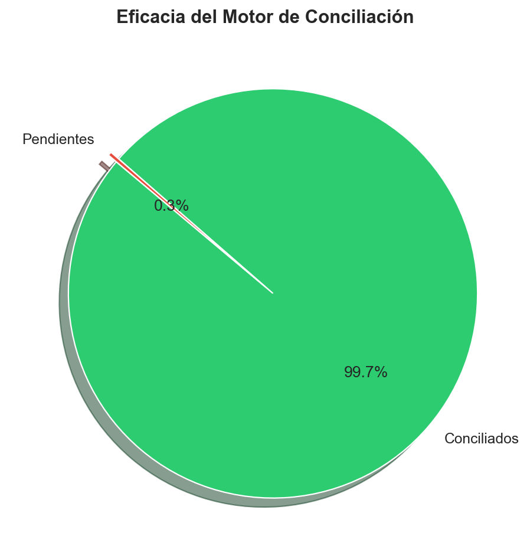
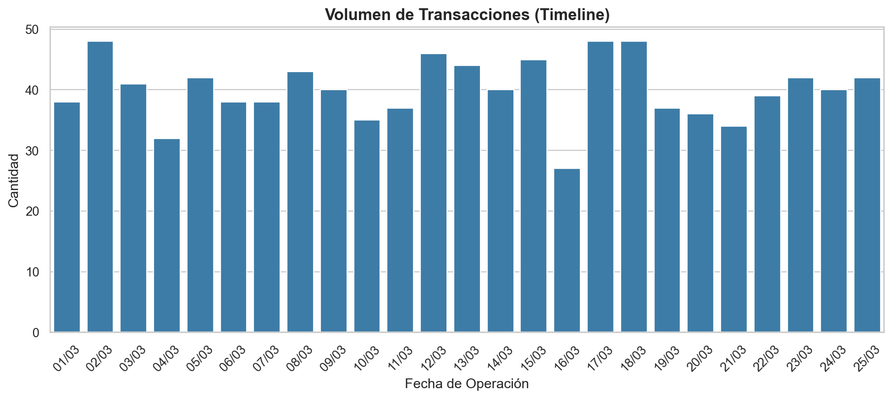

# 🏦 Conciliación Bancaria Automatizada - AuditSync Banking


**Autor:** Jonathan Nazareno Monserrat

**Stack:** Python · pandas · Matplotlib · Seaborn · Openpyxl

**Alcance:** Libro Mayor + Extracto Bancario · Conciliación exacta + Clearing hasta 3 días

---

## 📌 Descripción

Proyecto end-to-end de conciliación bancaria orientado a auditoría contable.
Automatiza el cruce entre Libro Mayor y Extracto Bancario para reducir trabajo manual, detectar excepciones y generar evidencia trazable para control interno o auditoría externa.

El flujo cubre todo el ciclo operativo:

```text
Generación de datos sintéticos -> Limpieza y normalización -> Match exacto -> Clearing temporal -> Reporte de conciliados y pendientes -> KPIs de gestión
```

---

## 🎯 Problema de negocio

En procesos manuales de conciliación suelen aparecer tres fricciones críticas:

1. Ineficiencia operativa: análisis fila a fila con alto consumo de horas.
2. Riesgo de error: descalces de fecha por clearing rompen cruces exactos.
3. Baja trazabilidad: diferencias y comisiones se detectan tarde, cerca del cierre.

---

## 🧩 Solución técnica

El pipeline está dividido en 3 etapas:

1. Generación de evidencia sintética

- Script: `src/generator.py`
- Crea datasets de mayor y banco con lógica financiera realista y ruido operativo controlado.

2. Motor de conciliación

- Notebook 01: exploración y limpieza de datos.
- Notebook 02: conciliación en dos niveles:
  - Nivel 1: Exact Match por fecha y monto.
  - Nivel 2: Clearing Engine con tolerancia de hasta 3 días para descalces temporales.

3. Dashboard de gestión

- Notebook 03: KPIs ejecutivos y visualización de eficacia.
- Consume salidas de `data/processed` para seguimiento de conciliados y excepciones.

---

## 📈 Resultados obtenidos

| Métrica                          | Resultado                           |
| -------------------------------- | ----------------------------------- |
| Eficacia de automatización       | 99.7%                               |
| Excepciones para revisión manual | 0.3%                                |
| Evidencia de salida              | conciliados + pendientes auditables |

Hallazgos clave:

- Automatiza el grueso del proceso y concentra el análisis humano solo en excepciones.
- Mejora la trazabilidad del cierre contable con archivos de salida verificables.
- Escala de forma natural a más cuentas y períodos.

### Visualizaciones del Dashboard

Las siguientes visualizaciones se generan en el Notebook 03 y reflejan los mismos indicadores ejecutivos del reporte:





---

## 🗂️ Estructura del proyecto

```text
AuditSync_Banking/
├── data/
│   ├── raw/                          # Datos de entrada
│   │   ├── extracto_bancario.csv
│   │   └── libro_mayor.csv
│   └── processed/                    # Evidencia de salida
│       ├── conciliados_final.csv
│       └── Partidas_Pendientes_Marzo.xlsx
├── docs/
├── notebooks/
│   ├── 01_Exploracion_y_Limpieza.ipynb
│   ├── 02_Motor_de_Conciliacion.ipynb
│   └── 03_Dashboard_Conciliation.ipynb
├── src/
│   └── generator.py
└── README.md
```

---

## 🛠️ Stack tecnológico

| Herramienta   | Uso                                        |
| ------------- | ------------------------------------------ |
| `Python 3.13` | Desarrollo del pipeline                    |
| `pandas`      | Limpieza, transformaciones y conciliación  |
| `Matplotlib`  | Visualizaciones base                       |
| `Seaborn`     | Visualización estadística                  |
| `Openpyxl`    | Exportación y manejo de evidencia en Excel |
| `pathlib`     | Gestión robusta de rutas                   |

---

## 🚀 Cómo ejecutar el proyecto

```bash
# 1) Crear entorno virtual
python -m venv .venv

# 2) Activación (Windows CMD/PowerShell)
.venv\Scripts\activate

# 2b) Activación (Git Bash en Windows)
source .venv/Scripts/activate

# 3) Instalar dependencias
pip install pandas matplotlib seaborn openpyxl

# 4) Generar datasets sintéticos
python src/generator.py
```

Orden de ejecución de notebooks:

1. `notebooks/01_Exploracion_y_Limpieza.ipynb`
2. `notebooks/02_Motor_de_Conciliacion.ipynb`
3. `notebooks/03_Dashboard_Conciliation.ipynb`

---

## 📦 Salidas esperadas

- `data/processed/conciliados_final.csv`
- `data/processed/Partidas_Pendientes_Marzo.xlsx`

Estas salidas constituyen evidencia de conciliación para revisión operativa y auditoría.

---

## 💼 Valor para negocio

- Reduce esfuerzo manual en conciliación de alto volumen.
- Mejora detección temprana de desvíos y partidas no conciliadas.
- Fortalece trazabilidad y soporte documental para auditoría.

---

## 🔭 Próximos pasos

1. Parametrizar tolerancia de clearing por tipo de transacción.
2. Incorporar pruebas automáticas del motor de conciliación.
3. Publicar dashboard interactivo en Streamlit o Power BI.

---

## 📬 Contacto

Jonathan Nazareno Monserrat  
Estudiante de Contador Público (UNC) y Data Analyst enfocado en finanzas, control y auditoría de procesos.

[](https://www.linkedin.com/in/jonathan-monserrat/)